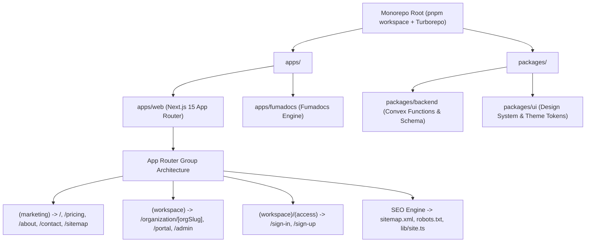

# General SaaS Boilerplate Monorepo — Handoff Guide & Implementation Plan

> **For New Agent Session**: Use this guide to initialize, configure, and verify a fresh, domain-agnostic B2B/B2C SaaS boilerplate from a clean state. It strips all domain-specific ISP code from `jmwired` while retaining the proven architecture patterns, design system rules, multi-tenant workspace routing, and crawler SEO engine.

---

## 1. Project Overview & Tech Stack

- **Goal**: Scaffold and configure an enterprise-grade, domain-agnostic SaaS boilerplate monorepo ready to be published as a GitHub Template.
- **Frontend App (`apps/web`)**: Next.js 15+ (App Router, Server Components, Typed Routes).
- **Documentation App (`apps/fumadocs`)**: Fumadocs MDX engine with full-text search.
- **Backend Package (`packages/backend`)**: Convex reactive document database, serverless queries/mutations.
- **UI Package (`packages/ui`)**: Tailwind CSS v4, Radix UI primitives, `@shadcn/lint` compliance.
- **Monorepo & Tooling**: Turborepo, Oxlint, PWA addon, pnpm v10/11 workspaces.



---

## 2. Global Constraints & Coding Rules

Every file created in the new repository must comply with these guidelines:

1. **Design System & Styling (`AGENTS.md`)**:
   - **No Restyling (`shadcn/no-restyle`)**: Do not override component padding, radius, or internal spacing with ad-hoc utility classes. Use predefined component `variant` and `size` props.
   - **Semantic Theme Colors Only (`shadcn/no-raw-colors`)**: Never use raw colors (e.g. `text-red-500`, `bg-blue-600`). Always use semantic tokens: `text-primary`, `bg-card`, `text-muted-foreground`, `border`, `bg-destructive`, `text-success`.
   - **No Arbitrary Classes (`shadcn/no-arbitrary-values`)**: Avoid `p-[13px]`, `w-[342px]`. Use standard Tailwind spacing scale (`p-3`, `p-4`, etc.).
   - **No Inline Styles (`shadcn/no-inline-styles`)**: No `style={{ ... }}`.
2. **Next.js Typed Routes**:
   - `typedRoutes: true` requires casting dynamic link paths using `href={`/organization/${org.slug}` as Route}` (import `{ type Route } from "next"`).
3. **Gitignore Pitfall**:
   - Avoid a bare `coverage` keyword in root `.gitignore` as it inadvertently ignores marketing paths like `app/(marketing)/coverage`. Use `/coverage` instead.
4. **Canonical Production Domain**:
   - Centralize domain resolution in `apps/web/src/lib/site.ts` with local fallback (`http://127.0.0.1:3000`) and production default.

---

## 3. Step-by-Step Execution Plan

### Task 1: Monorepo Scaffolding via Better-T-Stack

- [ ] **Step 1.1: Run the Better-T-Stack CLI initializer**
  Open terminal in your projects folder (e.g., `d:\Reyes-Prince-Client\`) and run:
  ```bash
  pnpm create better-t-stack@latest saas-starter \
    --frontend next \
    --runtime none \
    --backend convex \
    --api none \
    --database none \
    --orm none \
    --package-manager pnpm \
    --addons fumadocs,oxlint,pwa,turborepo
  ```
- [ ] **Step 1.2: Install dependencies & verify initial workspace**
  ```bash
  cd saas-starter
  pnpm install
  pnpm build
  ```
- [ ] **Step 1.3: Create root `AGENTS.md`**
  Write `AGENTS.md` at repo root to enforce design tokens and lint rules for all future AI agents:
  ```markdown
  # Agent Guidelines

  After making changes, run `pnpm lint` and fix all errors.

  ## Design System & Styling Rules
  This project enforces design system standards with `@shadcn/lint`:
  - **No Restyling (`shadcn/no-restyle`)**: Use predefined variants and sizes (`variant="outline"`, `size="sm"`).
  - **Theme Colors Only (`shadcn/no-raw-colors`)**: Use semantic tokens from `packages/ui/src/styles/globals.css` (`text-primary`, `text-muted-foreground`, `bg-card`, `border`, `bg-destructive`).
  - **No Arbitrary Values (`shadcn/no-arbitrary-values`)**: Use Tailwind layout scale.
  - **No Inline Styles (`shadcn/no-inline-styles`)**: Use Tailwind classes.
  - **Known Classes (`shadcn/no-unknown-classes`)**: Ensure all classes are valid utilities.
  ```

---

### Task 2: Multi-Tenant Schema Foundation (`packages/backend`)

**Files:**
- Create: `packages/backend/convex/schema.ts`
- Create: `packages/backend/convex/organizations.ts`
- Create: `packages/backend/convex/users.ts`

- [ ] **Step 2.1: Define generic multi-tenant schema in `packages/backend/convex/schema.ts`**
  ```typescript
  import { defineSchema, defineTable } from "convex/server";
  import { v } from "convex/values";

  export default defineSchema({
    users: defineTable({
      name: v.string(),
      email: v.string(),
      image: v.optional(v.string()),
      role: v.union(v.literal("user"), v.literal("admin")),
    }).index("by_email", ["email"]),

    organizations: defineTable({
      name: v.string(),
      slug: v.string(),
      ownerId: v.id("users"),
      plan: v.union(v.literal("free"), v.literal("pro"), v.literal("enterprise")),
      subscriptionStatus: v.union(v.literal("active"), v.literal("trialing"), v.literal("past_due"), v.literal("canceled")),
    }).index("by_slug", ["slug"]),

    memberships: defineTable({
      organizationId: v.id("organizations"),
      userId: v.id("users"),
      role: v.union(v.literal("owner"), v.literal("admin"), v.literal("member")),
    })
      .index("by_org", ["organizationId"])
      .index("by_user", ["userId"])
      .index("by_org_and_user", ["organizationId", "userId"]),
  });
  ```

- [ ] **Step 2.2: Add starter queries and mutations in `packages/backend/convex/organizations.ts`**
  ```typescript
  import { query, mutation } from "./_generated/server";
  import { v } from "convex/values";

  export const getBySlug = query({
    args: { slug: v.string() },
    handler: async (ctx, args) => {
      return await ctx.db
        .query("organizations")
        .withIndex("by_slug", (q) => q.eq("slug", args.slug))
        .unique();
    },
  });

  export const listUserOrgs = query({
    args: { userId: v.id("users") },
    handler: async (ctx, args) => {
      const memberships = await ctx.db
        .query("memberships")
        .withIndex("by_user", (q) => q.eq("userId", args.userId))
        .collect();

      const orgs = await Promise.all(
        memberships.map((m) => ctx.db.get(m.organizationId))
      );
      return orgs.filter((org) => org !== null);
    },
  });
  ```

---

### Task 3: Central Site Origin & Route Registry (`apps/web`)

**Files:**
- Create: `apps/web/src/lib/site.ts`

- [ ] **Step 3.1: Implement `src/lib/site.ts`**
  ```typescript
  export const siteConfig = {
    name: "SaaS Starter",
    description: "Modern full-stack B2B/B2C SaaS boilerplate built on Next.js, Convex, and Turborepo.",
    defaultOrigin: "https://your-saas-domain.com",
    links: {
      github: "https://github.com/your-username/saas-starter",
      docs: "/docs",
    },
  };

  export const siteUrl = (
    process.env.NEXT_PUBLIC_SITE_URL &&
    process.env.NEXT_PUBLIC_SITE_URL !== "http://127.0.0.1:3000" &&
    process.env.NEXT_PUBLIC_SITE_URL !== "http://localhost:3000"
      ? process.env.NEXT_PUBLIC_SITE_URL
      : process.env.NODE_ENV === "production"
        ? siteConfig.defaultOrigin
        : "http://127.0.0.1:3000"
  ).replace(/\/$/, "");

  export const marketingNavigation = [
    { href: "/features", label: "Features" },
    { href: "/pricing", label: "Pricing" },
    { href: "/about", label: "About" },
    { href: "/contact", label: "Contact" },
  ] as const;

  export const publicPages = [
    { href: "/", label: "Home" },
    ...marketingNavigation,
    { href: "/sitemap", label: "Sitemap" },
  ] as const;
  ```

---

### Task 4: Dynamic Crawler SEO Engine (`apps/web`)

**Files:**
- Create: `apps/web/src/app/sitemap.ts`
- Create: `apps/web/src/app/robots.ts`
- Create: `apps/web/src/(marketing)/sitemap/page.tsx`

- [ ] **Step 4.1: Create XML Sitemap (`src/app/sitemap.ts`)**
  ```typescript
  import type { MetadataRoute } from "next";
  import { publicPages, siteUrl } from "@/lib/site";

  export default function sitemap(): MetadataRoute.Sitemap {
    return publicPages.map((page) => ({
      url: `${siteUrl}${page.href}`,
      lastModified: new Date(),
      changeFrequency: (page.href === "/" ? "weekly" : "monthly") as const,
      priority: page.href === "/" ? 1.0 : 0.8,
    }));
  }
  ```

- [ ] **Step 4.2: Create Robots Rules (`src/app/robots.ts`)**
  ```typescript
  import type { MetadataRoute } from "next";
  import { siteUrl } from "@/lib/site";

  export default function robots(): MetadataRoute.Robots {
    return {
      rules: [
        {
          userAgent: "*",
          allow: "/",
          disallow: [
            "/organization/",
            "/portal/",
            "/admin/",
            "/account/",
            "/api/",
            "/sign-in",
            "/sign-up",
          ],
        },
      ],
      sitemap: `${siteUrl}/sitemap.xml`,
    };
  }
  ```

- [ ] **Step 4.3: Create Visual HTML Sitemap Directory (`src/app/(marketing)/sitemap/page.tsx`)**
  A clean page displaying all public directories with semantic cards, accessible to both crawlers and users.

---

### Task 5: Route Group Architecture (`apps/web`)

Configure the 3 primary route groups:

1. **`(marketing)` Public Group**:
   - `apps/web/src/app/(marketing)/layout.tsx`: Public header (Logo, Nav links, Docs link, Sign In CTA, Theme toggle) and footer.
   - `apps/web/src/app/(marketing)/page.tsx`: Hero, Features grid, Social proof, CTA banner.
   - `apps/web/src/app/(marketing)/pricing/page.tsx`: Pricing tier comparison (Free, Pro, Enterprise) with monthly/annual switch.
   - `apps/web/src/app/(marketing)/features/page.tsx`: Feature deep-dive cards.
   - `apps/web/src/app/(marketing)/about/page.tsx`: Mission statement and company values.
   - `apps/web/src/app/(marketing)/contact/page.tsx`: Contact form using semantic UI components.

2. **`(workspace)` Multi-Tenant Group**:
   - `apps/web/src/app/(workspace)/layout.tsx`: App sidebar layout, org switcher, user dropdown.
   - `apps/web/src/app/(workspace)/organization/[orgSlug]/page.tsx`: Tenant dashboard with KPI stat cards and activity feeds.
   - `apps/web/src/app/(workspace)/organization/[orgSlug]/settings/page.tsx`: Team members, invite modal, billing management.
   - `apps/web/src/app/(workspace)/portal/page.tsx`: End-user self-service portal (profile, active subscriptions, payment receipts).
   - `apps/web/src/app/(workspace)/admin/page.tsx`: System administration (tenant registry, platform analytics, system flags).

3. **`(access)` Authentication Group**:
   - `apps/web/src/app/(workspace)/(access)/sign-in/page.tsx`
   - `apps/web/src/app/(workspace)/(access)/sign-up/page.tsx`

---

### Task 6: Fumadocs Documentation Engine (`apps/fumadocs`)

**Files:**
- Configure: `apps/fumadocs/content/docs/index.mdx`
- Configure: `apps/fumadocs/content/docs/getting-started.mdx`
- Configure: `apps/fumadocs/content/docs/architecture.mdx`

- [ ] **Step 6.1: Seed starter docs covering:**
  - Getting started (installation, environment variables).
  - Multi-tenant architecture guide.
  - Adding new Convex queries and Next.js routes.
  - Design system tokens and `@shadcn/lint` rules.

---

### Task 7: Quality Verification & Git Template Publication

- [ ] **Step 7.1: Execute monorepo verification commands**
  ```bash
  pnpm lint
  pnpm check-types
  pnpm build
  ```
- [ ] **Step 7.2: Initialize clean Git repo and initial commit**
  ```bash
  git init
  git add .
  git commit -m "feat: initial saas boilerplate monorepo with better-t-stack"
  ```
- [ ] **Step 7.3: Push to GitHub & Enable Template**
  ```bash
  gh repo create your-username/saas-starter --public --source=. --push
  ```
  In GitHub Repository Settings -> **General** -> Check **"Template repository"**.

---

## 4. Prompt to Paste in the New Session

Copy and paste the block below into your first message in the fresh session:

```text
I am starting a fresh, domain-agnostic B2B/B2C SaaS boilerplate monorepo.
Please follow the handoff guide architecture:
1. Scaffold via Better-T-Stack:
   pnpm create better-t-stack@latest saas-starter --frontend next --runtime none --backend convex --api none --database none --orm none --package-manager pnpm --addons fumadocs,oxlint,pwa,turborepo
2. Enforce strict @shadcn/lint rules in AGENTS.md (no raw colors, no restyling, no arbitrary values).
3. Establish route groups in apps/web:
   - (marketing): /, /pricing, /features, /about, /contact, /sitemap
   - (workspace): /organization/[orgSlug], /portal, /admin
   - (access): /sign-in, /sign-up
4. Implement crawler SEO engine:
   - apps/web/src/lib/site.ts
   - apps/web/src/app/sitemap.ts (/sitemap.xml)
   - apps/web/src/app/robots.ts (/robots.txt)
5. Multi-tenant Convex backend schema in packages/backend/convex/schema.ts (users, organizations, memberships).
6. Verify quality gates with `pnpm lint`, `pnpm check-types`, and `pnpm build`.
```
